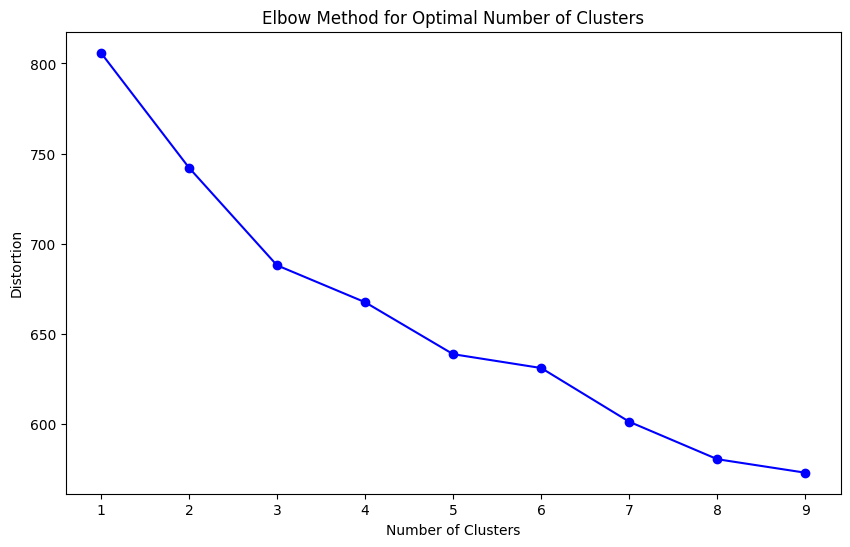
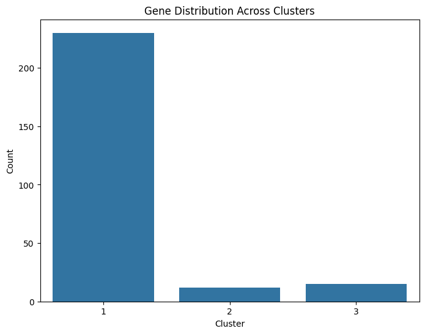

# Elucidation of potential miRNAs as prognostic biomarkers for coronary artery disease

Code and data for the study **"Elucidation of potential miRNAs as prognostic biomarkers for coronary artery disease"**, which uses machine learning to find microRNAs (miRNAs) that regulate genes involved in coronary artery disease (CAD) and its related conditions.

**Paper:** *Human Gene* (Elsevier), 2025 · [ScienceDirect](https://www.sciencedirect.com/science/article/abs/pii/S2773044125000117)

## Overview

Genes linked to CAD and its sequelae (valvular heart disease, valvular fibrosis, atherosclerosis, hyperlipidaemia, oxidative stress and inflammation) were collected from NCBI GTR and OMIM. miRNAs targeting each gene were identified with TargetScan and miRTarBase, keeping only species-conserved miRNAs with 8-mer seed matches to reduce off-target predictions.

The resulting gene–miRNA target data were analysed with two machine learning approaches:

- **Association rule mining (ARM)** with the Apriori algorithm, to find miRNAs that repeatedly co-target the same genes
- **Singular value decomposition (SVD)**, to rank miRNAs by how much they contribute to the main patterns in the gene–miRNA matrix

The miRNAs prioritised by both methods were compared with the Jaccard index. They were then checked for differential expression in two GEO miRNA datasets from cardiac patients, and placed in a miRNA–mRNA network to find hub regulators.

### Key findings

- **Strongest miRNA associations (ARM):** miR-141-3p → miR-200a-3p (lift 33), miR-1-3p → miR-206 and miR-429 → miR-200bc-3p (lift 28.9), and a co-targeting group of miR-32-5p, miR-92-3p, miR-367-3p, miR-25-3p and miR-363-3p.
- **Overlap between ARM and SVD:** Jaccard index 0.192, with five miRNAs found by both methods: miR-141-3p, miR-32-5p, miR-200a-3p, miR-92-3p and miR-367-3p.
- **Hub miRNAs:** miR-200a-3p, miR-32-5p and miR-92-3p had the highest Maximal Clique Centrality scores in the network and were also differentially expressed in patient datasets (GSE24548, GSE94605).
- **Candidate novel targets:** FBN1, COL1A2, BMPR2, PCSK9, PRKCE, DKK3, DSC2, PIK3CA, GATA2, KLF4 and SESN3 for miR-32-5p and miR-92-3p; PAPPA, P2RY1, VCAN, GATA6, TRHDE and OSGIN2 among the targets of miR-200a-3p.
- **Pathways:** targets were enriched in type 2 diabetes, cholesterol metabolism, p53 signalling, inflammation, and fluid shear stress and atherosclerosis.

## Repository structure

```
├── data/
│   └── mirnas_data_updated_unique.xlsx   Gene–miRNA target data (231 genes, 125 miRNAs, 7 disease categories)
├── notebooks/
│   └── genes_mirnas_code.ipynb           Exploratory analysis: K-means, PCA, Apriori and network graphs (Google Colab)
├── scripts/
│   ├── association_rule_mining.py       Apriori frequent itemsets and association rules
│   └── jaccard_index.py                  Overlap between ARM and SVD miRNAs
├── results/
│   ├── frequent_itemsets.csv
│   ├── association_rules.csv
│   ├── top_pairwise_rules.csv
│   ├── lift_heatmap.png
│   └── exploratory/                      Figures and cluster lists from the notebook
└── requirements.txt
```

## Data

`data/mirnas_data_updated_unique.xlsx` has one row per gene:

| Column | Description |
|---|---|
| `GENE` | Gene symbol |
| `miRNA` | Comma-separated list of conserved 8-mer miRNAs predicted to target the gene |
| `Disease` | Category the gene was collected for: `CAD`, `VAL -H` (valvular heart disease), `VAL -F` (valvular fibrosis), `ATHERO` (atherosclerosis), `HL` (hyperlipidaemia), `OS` (oxidative stress), `INF` (inflammation) |

The patient miRNA expression datasets used for validation are public on NCBI GEO: [GSE24548](https://www.ncbi.nlm.nih.gov/geo/query/acc.cgi?acc=GSE24548) and [GSE94605](https://www.ncbi.nlm.nih.gov/geo/query/acc.cgi?acc=GSE94605).

## Methods

### Association rule mining

The gene–miRNA data are converted into a binary matrix, with one row per gene and one column per miRNA, where 1 means the miRNA targets that gene. The Apriori algorithm finds frequent miRNA itemsets with a minimum support of 0.02, a low threshold chosen so that less frequent but potentially important combinations are kept. Association rules are then generated from these itemsets and ranked by **lift**, which measures how much more often two miRNAs target the same genes than would be expected by chance.

`scripts/association_rule_mining.py` reproduces the strongest rules reported in the paper (lift 33 and 28.875).

### Singular value decomposition

SVD decomposes the gene–miRNA matrix as **A = UΣVᵀ**. Each miRNA is scored from the magnitude of its components in **Vᵀ**, weighted by the singular values in **Σ**, and miRNAs are ranked by score. The top 20 miRNAs are reported in Table 3 of the paper. SVD code is not included in this repository.

### Jaccard index

The overlap between the miRNAs prioritised by ARM (Table 2 of the paper) and the top 20 miRNAs from SVD (Table 3) is measured with the Jaccard index, J(A, S) = |A ∩ S| / |A ∪ S|. `scripts/jaccard_index.py` computes it from the published lists: 5 shared miRNAs out of 26, giving **0.192**.

### Validation and network analysis

Differentially expressed miRNAs were identified in GSE24548 and GSE94605 with the limma package in R (adjusted p < 0.05, |log2 fold change| > 1). Hub miRNAs and their targets were placed in a miRNA–mRNA network in Cytoscape (v3.10.1), and hub nodes were ranked by Maximal Clique Centrality with the CytoHubba plugin. Target genes were checked for pathway and disease enrichment with ShinyGO and DisGeNET (Metascape). These steps are described in the paper and are not part of this repository.

## Exploratory analysis

`notebooks/genes_mirnas_code.ipynb` explores the same gene–miRNA data with unsupervised learning. This analysis is not reported in the paper.

- **K-means clustering:** the elbow method suggested k = 3. Genes were grouped by their miRNA targeting patterns into one large cluster with broad miRNA regulation and two smaller clusters with more specific miRNA–gene interactions. Silhouette score 0.27, Davies-Bouldin index 1.46.
- **PCA:** projects the gene–miRNA matrix onto two principal components to show how well the clusters separate.
- **Apriori and network graphs:** frequent miRNA itemsets and rules (minimum support 0.03), plus bipartite graphs of miRNA–gene links within each cluster.

| Elbow method | Gene distribution across clusters |
|---|---|
|  |  |

The genes in each cluster are listed in [`results/exploratory/kmeans_clusters.md`](results/exploratory/kmeans_clusters.md).

## How to run

### Scripts

```bash
git clone https://github.com/Summan-Thahiem/cad-mirna-biomarkers.git
cd cad-mirna-biomarkers
pip install -r requirements.txt

python scripts/association_rule_mining.py
python scripts/jaccard_index.py
```

Results are written to `results/`.

### Notebook

The notebook was written for Google Colab and reads the data from Google Drive. To run it, open it in Colab, upload `data/mirnas_data_updated_unique.xlsx` to your Drive, and set `data_path` to that file. The notebook keeps miRNA names exactly as they appear in the spreadsheet, including spaces after commas, so its association rules differ slightly from the script's.

## Citation

Thahiem S, Iftekhar MF, Faheem M, Ishtiaq A, Jan MI, Khan RA, Murtaza I. Elucidation of potential miRNAs as prognostic biomarkers for coronary artery disease. *Human Gene*. 2025. https://www.sciencedirect.com/science/article/abs/pii/S2773044125000117
